##3D náhled
{: style="width:70%;" }
 
 
{: style="width:70%;" }

##Popis komunikace, vstupů/výstupů a ovládání
###Komunikační rozhraní
- Ethernet 100/1000 Mb/s s UDP protokolem, určen pro záznam parametrů, monitorování, testování, ale také online ovládání.
- CAN bus protokol lze upravit podle požadavků zákazníka.
- Ethernet 100/1000 Mb/s s volitelným protokolem, naprogramovaný v hradlovém poli a určený pro připojení rychlých průmyslových sběrnic pro řízení v reálném čase.
  V současné době je toto rozhraní vybaveno protokolem EtherCAT (pouze pro standardní firmware); podle požadavků zákazníka lze upravit na jiný typ protokolu.
  
###Vstupy / výstupy
Servozesilovače TGZ v tomto provedení mají 8 digitálních vstupů, 6 digitálních výstupů a dva obecné analogové vstupy 0-10 V.
Tyto vstupy/výstupy je možné číst/ovládat pomocí uživatelského programu (jazyk C).
Digitální výstupy lze ovládat i přes ovládací servisní software TGZ GUI.

| I/O     | Typ              | Počet | Hodnota                                             |
|---------|------------------|--------|----------------------------------------------------|
| vstup   | analogový        | 2      | 0-10 V                                             |
| vstup   | izolovaný digitální | 8   | 0-24 V (0-10 V low/13-24 V high), 10 mA          |
| výstup  | izolovaný digitální | 6   | 5-24 V, 300 mA / max. výstup                     |

| Typ   | Standard              | Rozhraní                         | Příklady připojení možných zařízení                                                                                               |
|-------|-----------------------|----------------------------------|-----------------------------------------------------------------------------------------------------------------------------------|
| FB1   | RS422/RS485           | Hiperface DSL, EnDat 2.2, SSI, BISS | Absolutní magnetický / optický enkodér, inkrementální magnetický / optický enkodér s Hallovými senzory [^2], gyroskop              |
| FB2   | RS422/RS485           | Hiperface DSL, EnDat 2.2, SSI, BISS | Absolutní magnetický / optický enkodér, inkrementální magnetický / optický enkodér s Hallovými senzory [^2], gyroskop              |
| FE[^1]   | RS422/RS485           | Hiperface DSL, EnDat 2.2, SSI, BISS | Absolutní magnetický / optický enkodér, inkrementální magnetický / optický enkodér s Hallovými senzory [^2], gyroskop              |                                                                             |

[^1]: Tento typ pracuje pouze s upraveným firmwarem. Jeho použití se doporučuje vždy konzultovat s výrobcem.
[^2]: Hallovy senzory musí být připojeny k digitálním vstupům pomocí speciálního převodníku úrovní, viz. [Převodník Hall-TGZ](../../../ETC/TGHall/md/description.md#TGhall_1).

- Hiperface DSL - digitální komunikace, senzory jsou vyráběny s rozlišením 15 až 24 bitů na otáčku (vícerychlostní provedení - 4 096 otáček).
  Tento typ zpětné vazby se používá pro motory s jediným konektorem nebo kabelem.
- EnDat 2.2 - digitální komunikace, senzory jsou vyráběny s rozlišením 18 až 25 bitů na otáčku (vícerychlostní provedení - 4 096 otáček).
- SSI - enkodéry se synchronním systémovým rozhraním.
- BISS - senzory s protokolem BISS-C.

###Řízení
Servozesilovače TGZ je možno řídit:

- digitální ovládání přes EtherCAT, CAN-bus (točivý moment, otáčky, polohové profily atd.) A přes Ethernet UDP protokol;
- uživatelský program (jazyk C) - digitální vstupy, analogové napětí atd.

##Konektory
___
### Strana komunikace/ethernet/ethercat
___

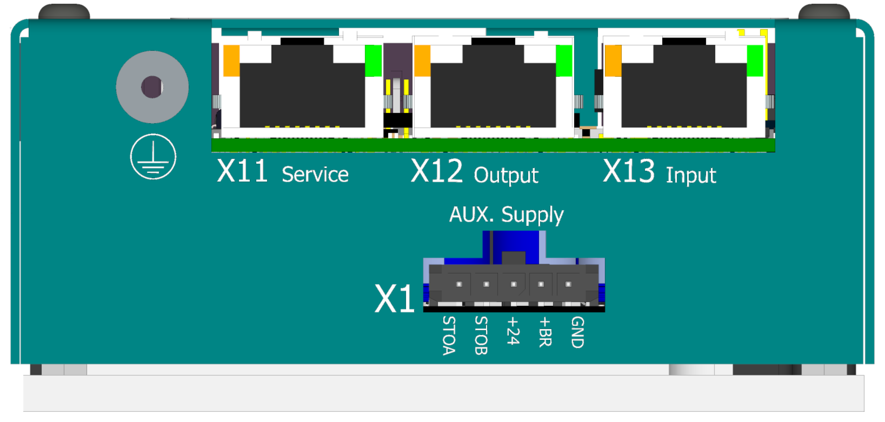{: style="width:80%;" }

-   **X1 - Napájení řídicí části**

    ---
	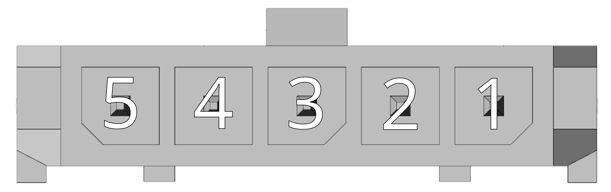{: style="width:90%;" }
	
	Pohled na protikus ze strany PCB:
	
	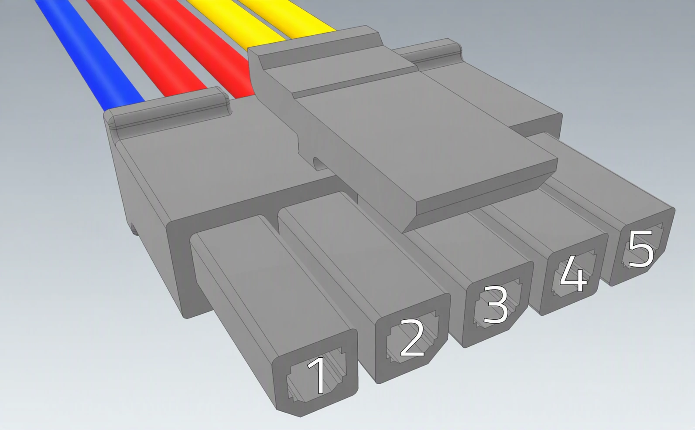{: style="width:90%;" }
	
	Pohled na protikus ze strany vodičů:
	
	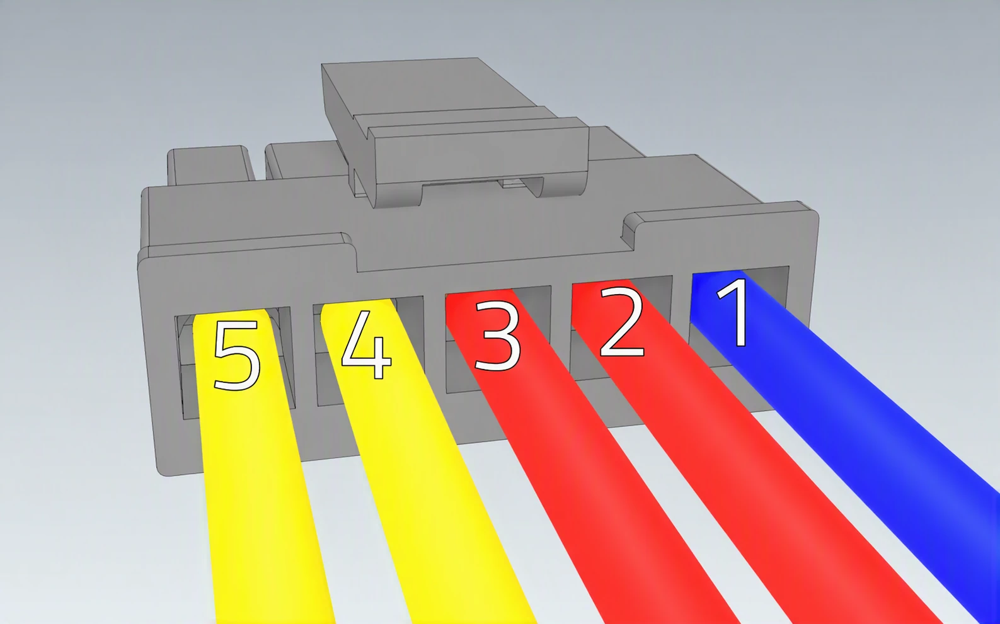{: style="width:90%;" }	
	
-    Molex Micro-Fit 3.0 - 436450500. Doporučené krimpovací kontakty [Molex 43030](https://www.molex.com/en-us/part-list/43030). [^4]

	---

	--8<-- "md/X1_24V_5pin_Microfit_60_125.md"
	
	!!! warning "Odrušení přívodu"
	
		Věnujte prosím pozornost instalaci odrušovacího toroidu dle [návodu](../../../../source/md/logicPWR.md#LogicPWR_EMI).

___
### Strana CAN/IO/SD
___

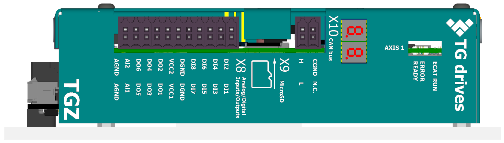{: style="width:80%;" }

-   **X8 - Digitální I/O, analogové vstupy**

    ---
	Pohled zezadu (strana kabelu)   
	
	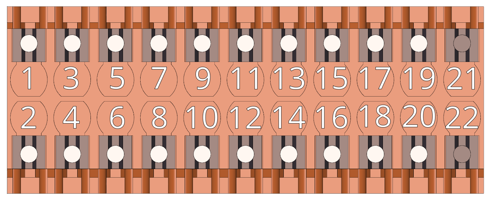{: style="width:100%;" }
	3D pohled zezadu   
	
	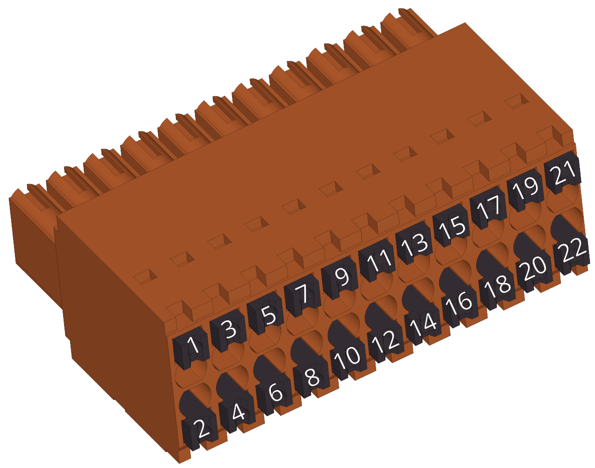{: style="width:100%;" }
	Pohled zepředu (strana TGZ)   
	
	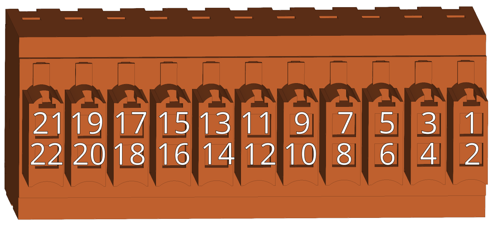{: style="width:100%;" }

	Detailní soupis parametrů 
	[digitálních vstupů DI1-8](../../../../source/md/commonHW_DI.md#commonDI1-8), 
	[digitálních výstupů DO1-6](../../../../source/md/commonHW_DO.md#commonDO1-6) a 
	[analogových vstupů AI1-2](../../../../source/md/commonHW_AI.md#commonAI1-2) 
	naleznete v sekci [Společný HW](../../../../source/md/commonHW_DI.md#commonDI1-8).
	

-    Weidmüller B2CF 3.50/22/180 SN OR BX

	---

	--8<-- "md/X8_IO_22pin_B2CF.md"
	
	!!! warning "Pozor"	
	
		Pro správnou funkci DI(1-6) je potřeba připojit alespoň jedno z VCC DO (pin 11 a 12). Vstupy DI7,8 jsou nezávislé na napájecím napětí DO VCC a fungují korektně i bez něj.
	
-   **X9 - MicroSD karta**

    ---
	
	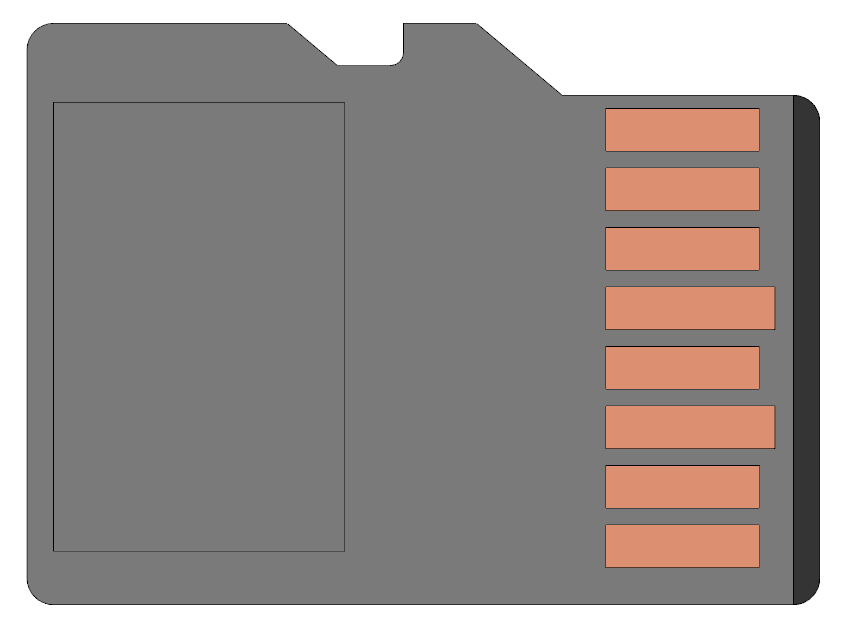{: style="width:60%;" }

-    Použijte standardní microSD kartu. Karta je součástí dodávky servozesilovače TGZ. Více informací naleznete v sekci [SD karty](../../TGZ_SW/SD/md/SD.md#SDparams).

-   **X10 - CAN**

    ---
	Pohled zezadu (strana kabelu)   
	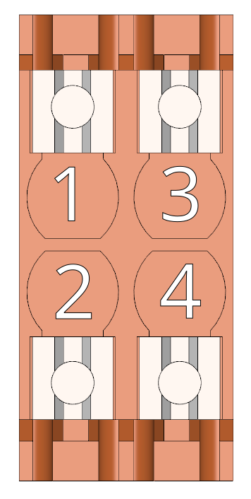{: style="width:25%;" }
	
	3D pohled zezadu   
	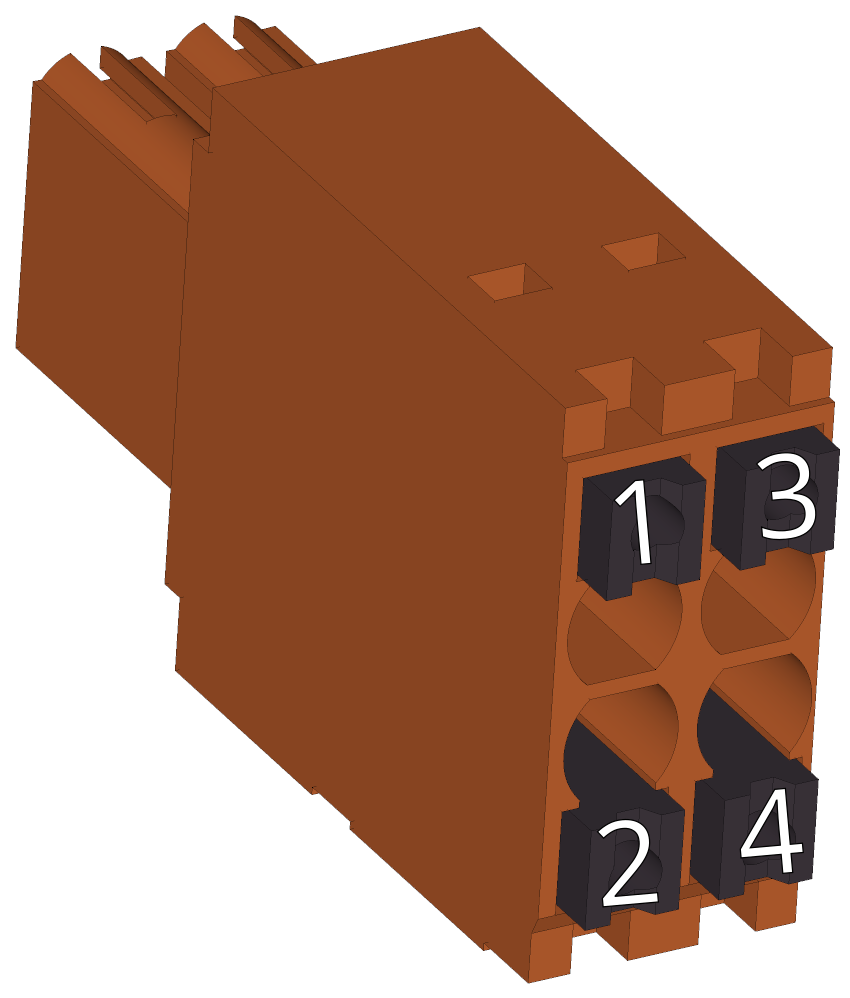{: style="width:45%;" }
	
	Pohled zepředu (strana TGZ)   
	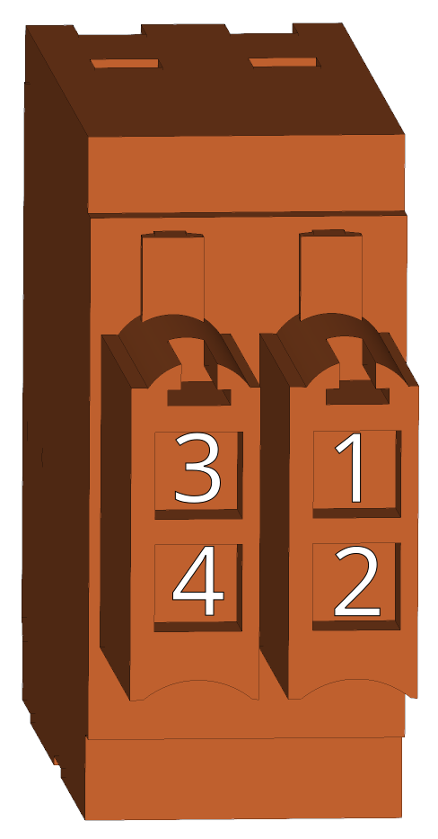{: style="width:35%;" }

-    Weidmüller B2CF 3.50/04/180 SN OR BX

    ---

	--8<-- "md/X10_CAN_4pin_B2CF.md"
	
	Další informace o HW provedení sběrnice CAN naleznete v sekci [Sběrnice CAN](../../../../source/md/commonHW_CAN.md#commonCAN).
	
-	**LED displej**

	---
	
	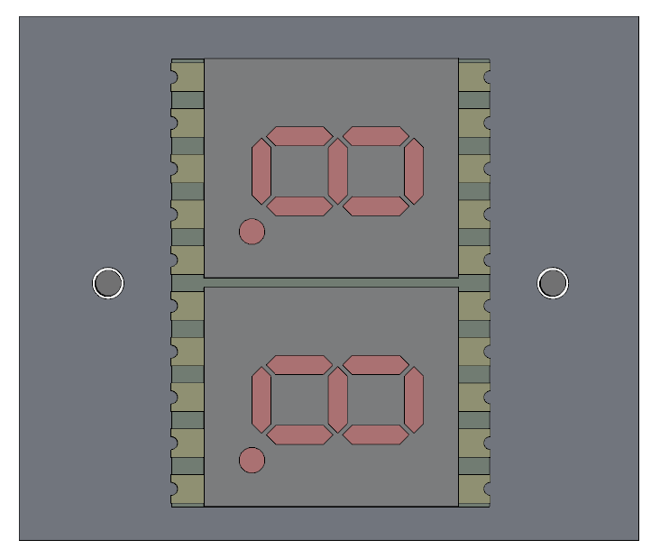{: style="width:60%;" }
	
-	LED displej signalizuje stavy viz. [Význam stavových indikátorů TGZ](../../TGZ_SW/LED/md/description.md#LED_sigs)

-	**LED signalizace**

	---
	
	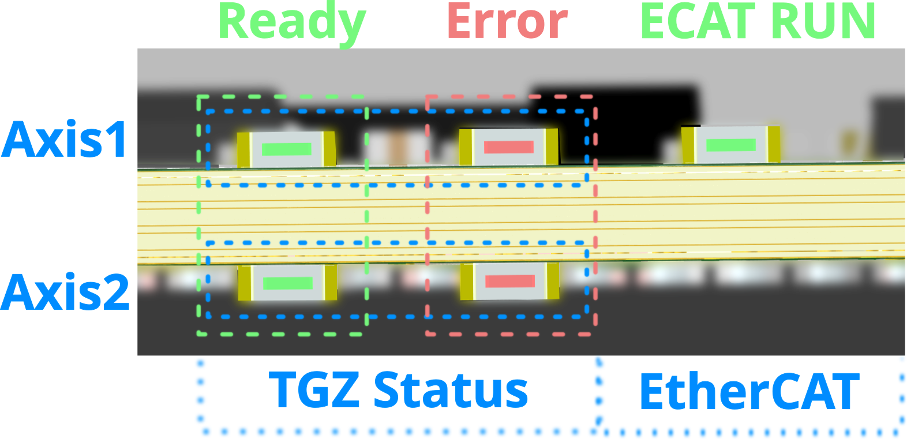{: style="width:100%;" }
	
-	LED diody

	---
	
	--8<-- "md/LEDsigAx12.md"
	
	Kompletní popis významu stavových LED diod naleznete zde: [Význam stavových indikátorů TGZ](../../TGZ_SW/LED/md/description.md#LED_sigs)

   
___
### Strana motor/feedback
___

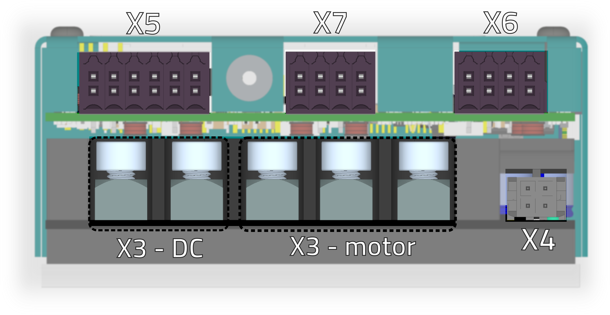{: style="width:80%;" }

-   **X5 - Externí enkodér (FBE)**

    ---
	Pohled zezadu (strana kabelu) 	
	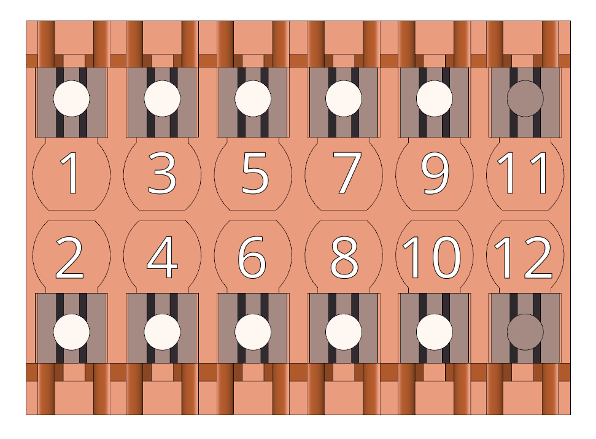{: style="width:60%;" }
	
	3D pohled zezadu   
	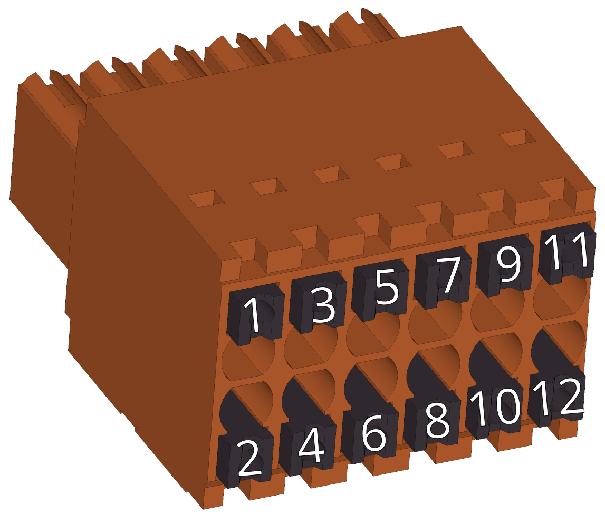{: style="width:60%;" }
	
	Pohled zepředu (strana TGZ)   
	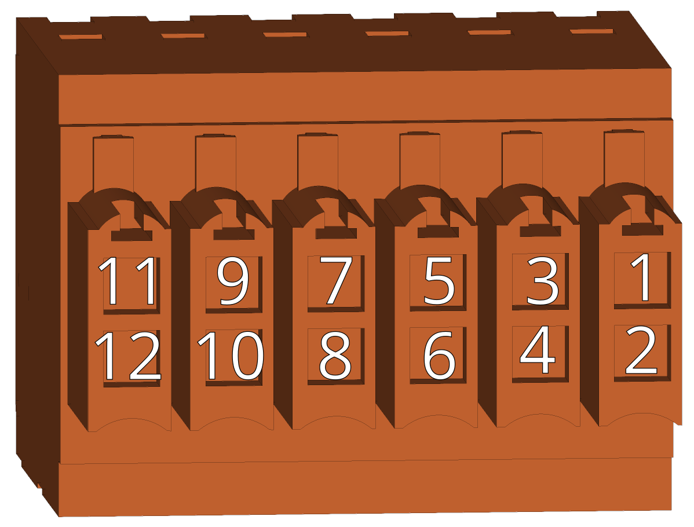{: style="width:60%;" }	

-    Weidmüller B2CF 3.50/12/180 SN OR BX

	---

	--8<-- "md/X5_FBE_12pin_B2CF.md"
	
	Další informace ohledně externí zpětné vazby naleznete v sekci [Zpětná vazba FBE](../../../../source/md/commonHW_FBE.md#commonFBE).

-   **X6 - Zpětná vazba - osa 1**

    ---
	
	Pohled zezadu (strana kabelu) 	
	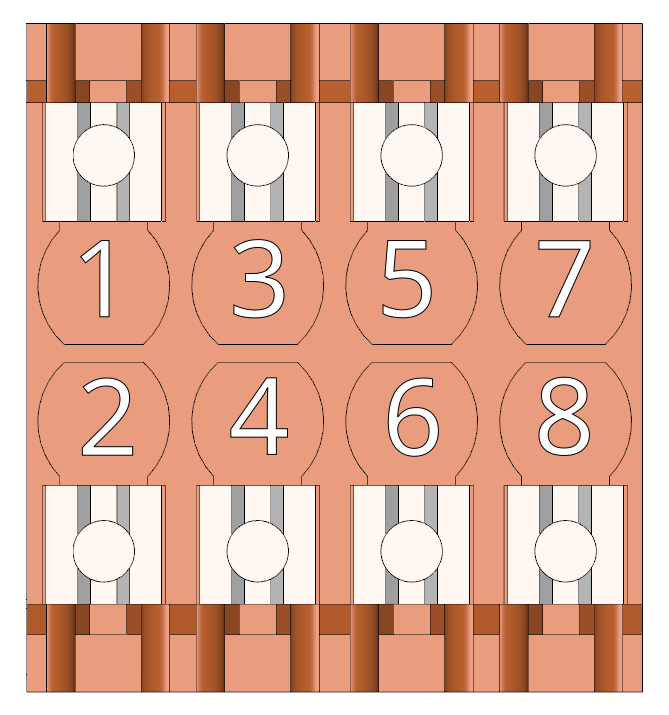{: style="width:50%;" }
	
	3D pohled zezadu   
	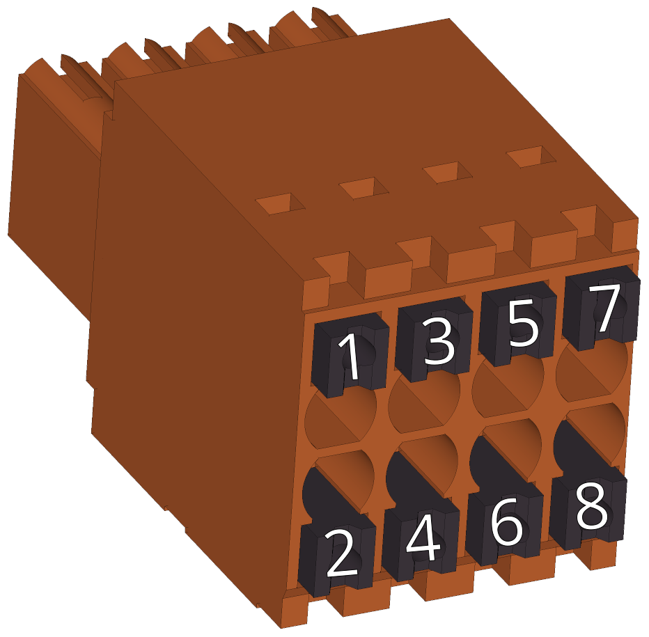{: style="width:50%;" }
	
	Pohled zepředu (strana TGZ)   
	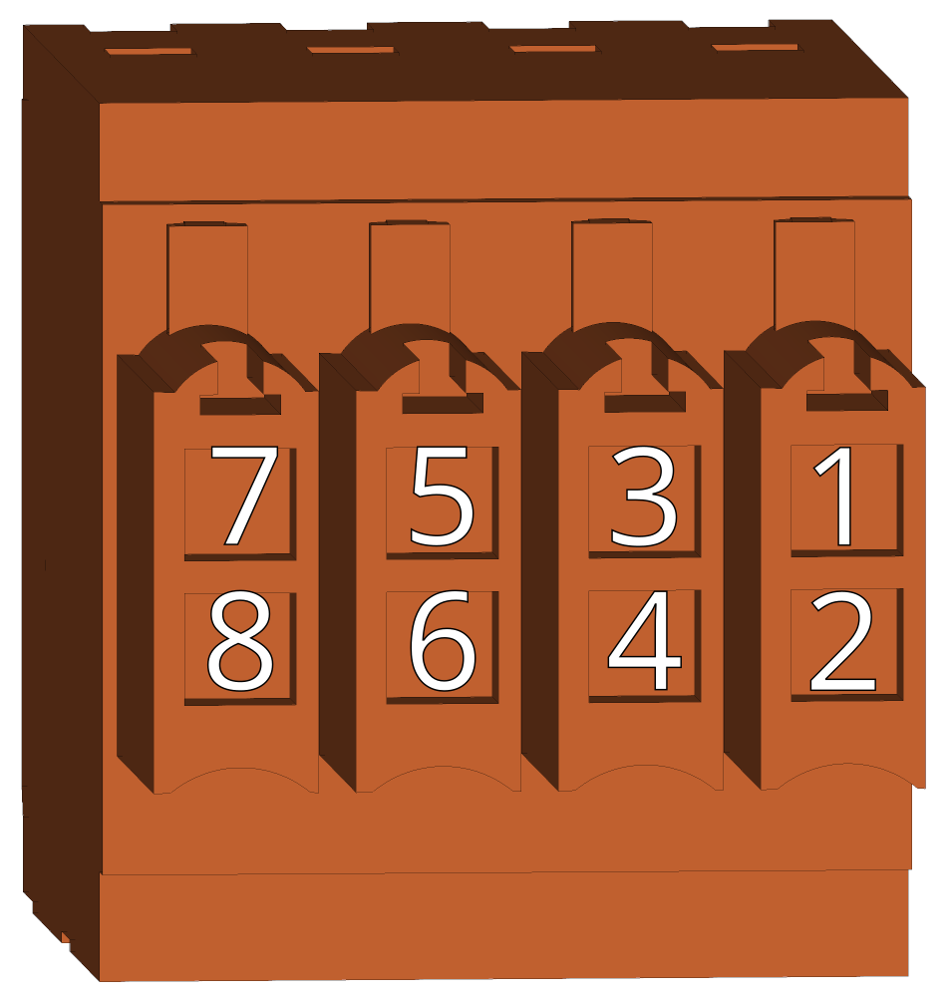{: style="width:50%;" }

-    Weidmüller B2CF 3.50/08/180 SN OR BX

    ---

	--8<-- "md/X6_FB1_8pin_B2CF.md"
	
	Další informace ohledně zpětné vazby 1 naleznete v sekci [Zpětná vazba FB1, FB2](../../../../source/md/commonHW_FB12.md#commonFB12).
	
-   **X7 - Zpětná vazba - osa 2**

    ---
	
	Pohled zezadu (strana kabelu) 	
	{: style="width:50%;" }
	
	3D pohled zezadu   
	{: style="width:50%;" }
	
	Pohled zepředu (strana TGZ)   
	{: style="width:50%;" }

-    Weidmüller B2CF 3.50/08/180 SN OR BX

    ---

	--8<-- "md/X7_FB2_8pin_B2CF.md"
	
	Další informace ohledně zpětné vazby 2 naleznete v sekci [Zpětná vazba FB1, FB2](../../../../source/md/commonHW_FB12.md#commonFB12).

-   **X3 - Napájení silové části**

    ---
	
	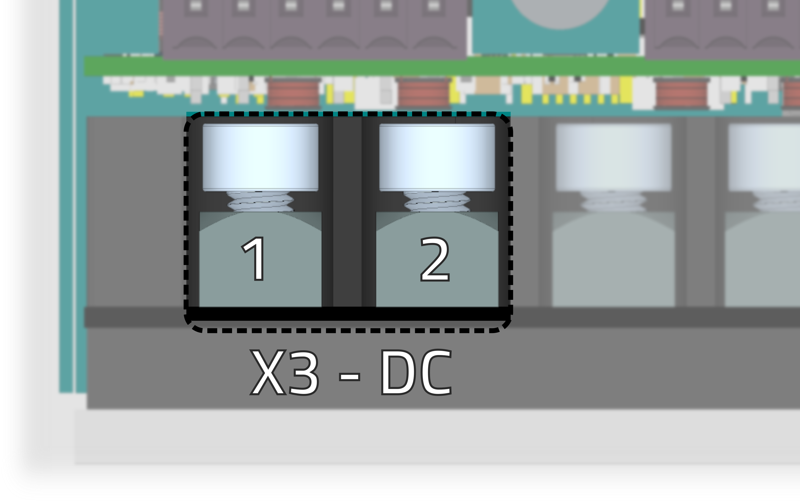{: style="width:80%;" }

-    Pressfit M5 - doporučené kabelové oko [JST GS5-10](https://www.tme.eu/cz/details/gs5-10/konektory-neizolovane/jst/)

    ---

	--8<-- "md/X2_DCbus_2pin_pressfit.md"
	
	!!! info "Dotahovací moment"
	
		Maximální dotahovací moment pro pressfit M5 je  2,2 Nm.
	
	!!! warning "Regenerativní brzdění"
	
		V případě, že pohon není napájen z akumulátoru (např. Li-ion bateriový pack) 
		je u strojů s větší kinetickou energií nutné zajistit její zmaření např. v odporovém tělese pomocí brzdné jednotky.
		
-   **X3 - Připojení motoru**

    ---
	
	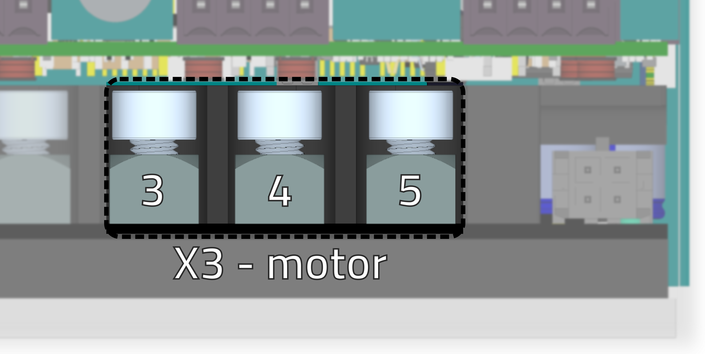{: style="width:80%;" }

-    Pressfit M5 - doporučené kabelové oko [JST GS5-10](https://www.tme.eu/cz/details/gs5-10/konektory-neizolovane/jst/)

    ---
	
	--8<-- "md/X2_M1_3pin_pressfit.md"

	!!! info "Dotahovací moment"
	
		Maximální dotahovací moment pro pressfit M5 je  2,2 Nm.	

-   **X4 - Statická brzda + teplota motoru**

    ---
	
	Pohled na PCB konektor:
	
	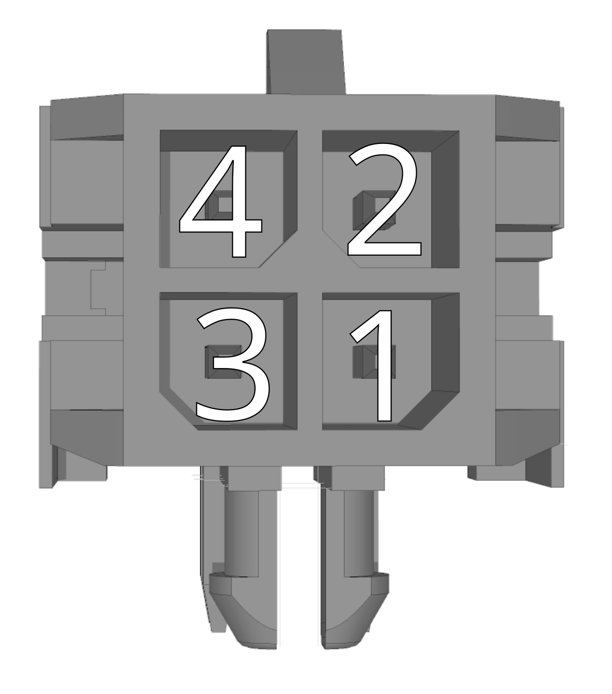{: style="width:60%;" }
	
	Pohled na protikus ze strany PCB:
	
	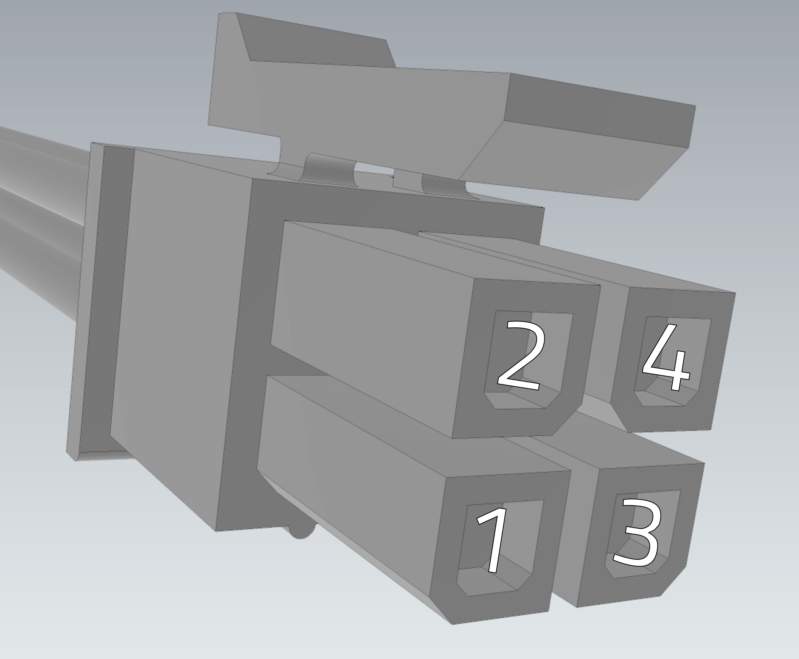{: style="width:60%;" }
	
	Pohled na protikus ze strany vodičů:
	
	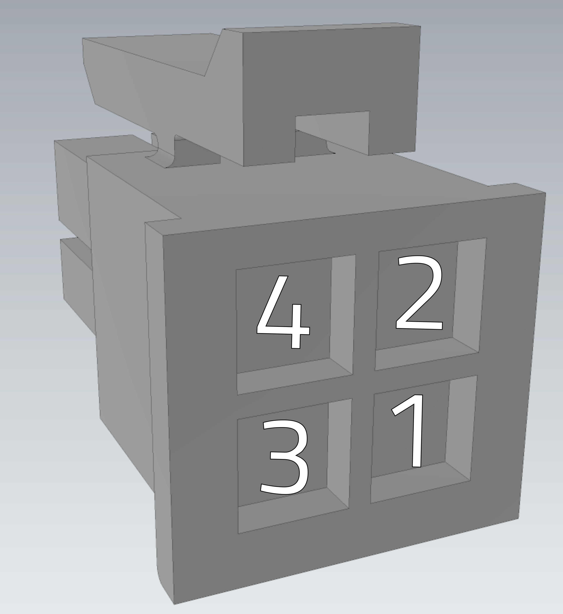{: style="width:60%;" }
	
-    Molex Micro-Fit 3.0 - 430250400. Doporučené krimpovací kontakty [Molex 43030](https://www.molex.com/en-us/part-list/43030). [^4]

	---

	--8<-- "md/X3_BR_4pin_Microfit.md"
	
	Servozesilovač je vybaven vylepšeným obvodem ovládání statické motorové brzdy.
	Více informací ohledně nastavení důležitých parametrů naleznete v sekci [Chytrá brzda](../../../../source/md/commonHW_SmartBrake.md#SmartBrakeDesc).
		
	!!! info "Konektorové krimpy"
	
		Přizpůsobte typ krimpů zvolenému průřezu vodiče.
		

[^4]: Při krimpování a zapojování konektorů systému Molex Micro-Fit postupujte dle [Aplikačního návodu Molex Micro-Fit](https://www.molex.com/content/dam/molex/molex-dot-com/products/automated/en-us/applicationtoolingspecificationpdf/638/63819/ATS-638190000-001.pdf) a použijte krimpovací nástroj [638190000](https://www.molex.com/en-us/products/part-detail/638190000).