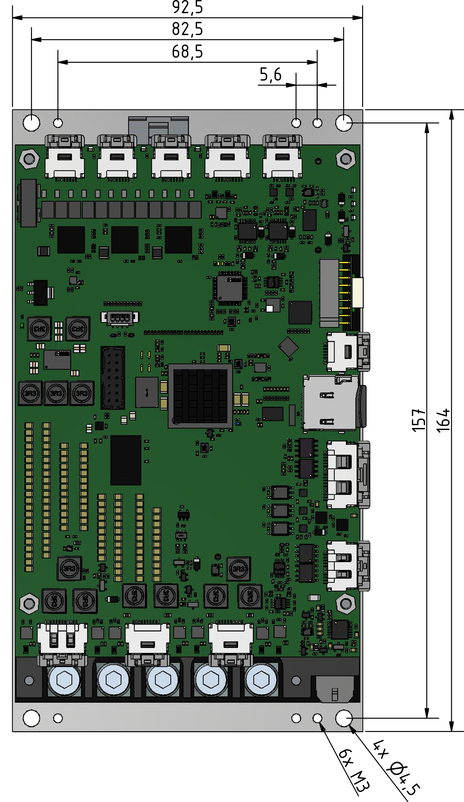

##Mounting
The L-profile allows variable mounting of the servoamplifier in the control cabinet or directly on the machine.
Below are the dimensions and position of the individual mounting elements.

--8<-- "md/mechMounting.en.md"

